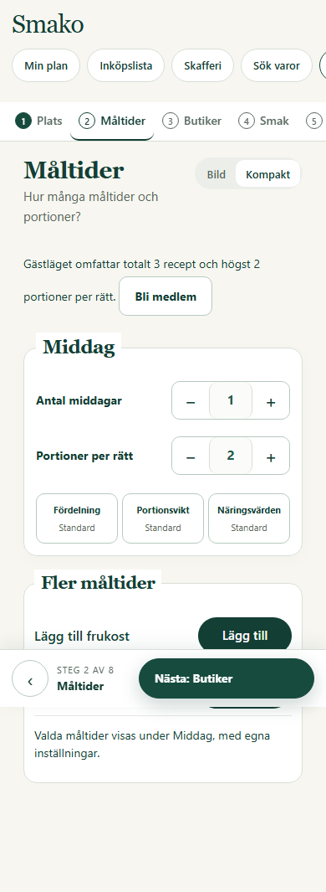
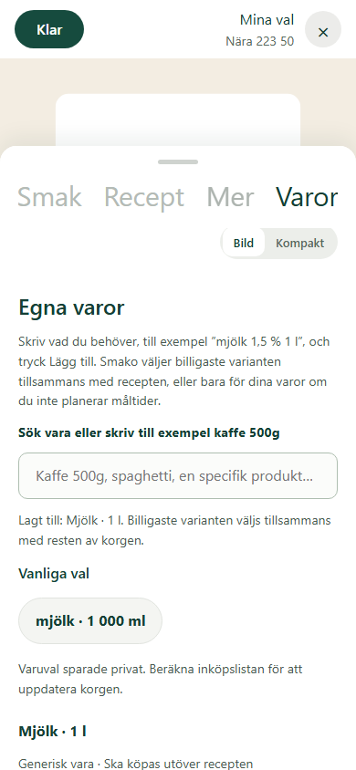

# Mobilkonfigurator och generiska inköpsvaror aktiverade

Aktiverad 2026-10-30T22:17:54.177041+00:00 på https://beta.smako.nu.
PR [51](https://github.com/ossebosse/smako/pull/51) är integrerad i `main`
med merge `b3316106adb29238be718ff978571368fae4d0c2`. Kod `562afbb533445665f7083ca143f7a2e988375034` och main hade vid kodmergen exakt samma
Git-träd. Dagens PR50 var redan integrerad och omfattar CI-överblicken.

## Användarflöde

Startsidan går till `/personal`; den tidigare middagsplaneringen finns på
`/klassisk`. Mobilens Mina val har stegen Plats, Måltider, Butiker, Smak,
Recept, Mer, Varor och Sammanfattning. Bild- och kompaktläge delar valen;
layoutvalet sparas lokalt. Egna varor kan läggas till före receptplaneringen.

Generiska varor är huvudvägen i inköpssökningen och läggs till med ett tryck.
Nya exakta produktval binds till en generisk vara via befintliga produktindex
och egenskapskontroller; planeraren kontrollerar kopplingen på nytt.
Tidigare sparade inköpsrader kan fortfarande återläsas och redigeras.

## Verifiering och runtime

- PR-CI och [main-CI](https://github.com/ossebosse/smako/actions/runs/41133702218) är gröna. PR-sviten omfattar
  4 447 testfall: 4 384 godkända och 63 överhoppade/förväntade fel.
- Lokalt: 51 riktade tester godkända, ett förväntat fel; 66 webbläsartester
  godkända i Chromium och WebKit. Ruff, compileall och visuell kontroll passerar.
- Första main-körningen fick 267 ms mot 200 ms i ett oförändrat
  telemetritest. PR-körningen, separat lokal kontroll och omkörningen av
  felade CI-jobb passerade. Test, tidsgräns och produktkod ändrades inte.
- Exakt kandidatimage provades med HTTP/API, generisk produktkoppling,
  negativ egenskapskontroll, checkout och återläsning av sparade rader.
  Provet använde separata temporärdata utan nät eller produktionsmountar.
- Första publika mobilprovet med en middag för två plus en generisk mjölkrad
  gav SEARCH_INCOMPLETE efter 63,406 s, utan slutkontrollerad lista. Det räknas
  inte som framgång. Den breda kombinationen nådde tidsgränsen även vid
  ett senare försök. Ett separat avgränsat prov med italienskt matkök och
  högst en butik, fortfarande en middag för två plus mjölk inom 3 km,
  tog 40,14 s till resultat;
  kostnad 110,55 kr, status `VERIFIED`.
  Checkout-audit passerade och sparad request/plan återlästes identiskt.
  Layoutbyte, varutillägg och återladdning av menyn fungerade utan JavaScriptfel.
  Det avgränsade provet bevisar inte lyckad latens för den breda kombinationen eller
  global optimalitet. Samma typ av förstaförsök finns dokumenterat i
  [tidigare aktivering](../beta-ica-recipes-20261028/ACTIVATED.md).
  Orsaken till tidsgränsen är inte fastställd; inga krav eller tidsgränser ändrades.
  Ett tidigare omprov fick 201 efter 60,344 s men inspektionscachen tappade
  svarskroppen. Ett efterföljande testskripts väntan stoppades av sidans CSP.
  Dessa verktygsfel räknas inte som godkända auditprov. Slutprovet använde
  synligt renderad meny och två behöriga återläsningar av sparad request/plan.

App BUILD_ID: `app-562afbb53344-92f00d23`.
Image: `sha256:d6b0b3c238edd29df9755c7f157e38149be467fab759783ef73df356f879eaaf`.
Faktisk appbas: `sha256:c81c507598a418dc5378492ec678cf9f32c1e2cde21e168e2b2634ffefb6fbd4`.
Exakt 15 granskade appfiler ändrades; 993 övriga runtimefiler och
basbildens runtimekonfiguration verifierades. Schedulern består på
`source-ops-8a53beb80e43`; proxy, scheman och prisinsamling ändrades inte.

## Säkerhetskopiering och bevarande

Befintligt driftlås hölls över backup och appbyte. Releasebackup:
`/srv/smako/backups/20261030T220550Z`. Alla 315 tidigare
planrevisioner, 124 privata tillstånd,
2 konton och en session
verifierades som bevarade. Mountar, befintlig miljö utom BUILD_ID och båda
kommunernas prismanifest består. Lund och Malmö gav HTTP 200/ready med nya BUILD_ID.

Serverns byggcache gav inget ytterligare utrymme. Den extra backupen
`20261029T194337Z` arkiverades därför först i en åtkomstskyddad lokal fil under
`.local/mobile-beta-20261030/protected-backup/`. Samtliga manifestfiler
hashverifierades efter överföringen. Därefter förroterades just den kopian
med befintlig retention under driftlåset; de två senaste fullständiga kopiorna
hashverifierades och behölls. Antalsgränsen två gällde endast denna
underhållsprocess; installerad policy är oförändrad och releasebackupen
återställde den tredje kopian. Ingen backup finns i Git.

Retentionskontrollen efter aktiveringen är `complete`.
Den sedan tidigare konservativa kapacitetsvarningen och prisernas åldersvarningar
ska fortsatt följas i ordinarie drift. Sista kontrollen visade cirka 8,43 GB
ledigt mot indikatorns uppskattade behov 15,21 GB. Kvalificerade baspriser behålls enligt
befintlig policy tills validerad ersättning finns.

Sanerat underlag: [EVIDENCE.json](EVIDENCE.json).
