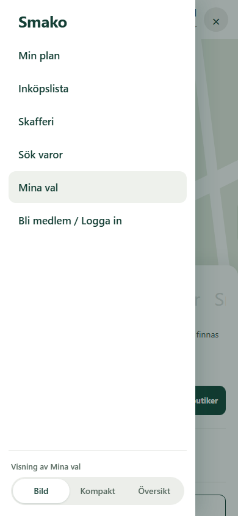
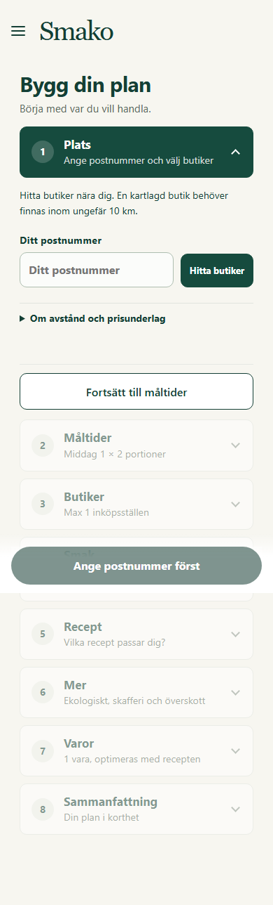

# Mobilmeny och Översikt aktiverade

Aktiverad 2026-10-31T08:14:14.970996+00:00 på https://beta.smako.nu.
PR [52](https://github.com/ossebosse/smako/pull/52) integrerades på main
med merge `3f52b0ead817b0336fe372a7c217495cfb0c7cbd`. Kod `bbf62d741a99d08bc02f481b055cb85ad0136829` hade exakt samma
Git-träd som kodmergen. Push ensam aktiverar inte betan.

## Ändring och verifiering

På mobil öppnas huvudnavigationen med en menyknapp uppe till vänster.
Menyn innehåller Bild, Kompakt och det nya Översikt. Översikt visar alla åtta
steg som kort, ett öppet i taget, med valens befintliga sammanfattning och en
fast knapp för att skapa plan. Samma formulärvärden, validering och API används.
Datorvyn behåller sin vanliga navigation.

Alla 108 riktade tester passerade, inklusive Chromium/WebKit, medlemskap,
PWA och paketering. Ruff, compileall och visuell kontroll passerade.
PR-CI och [main-CI](https://github.com/ossebosse/smako/actions/runs/41182566424) är gröna.
Main-körningen gav 4 388 godkända och 63 överhoppade tester, utan fel.
Exakt kandidatimage passerade isolerade HTTP-/API-, sparnings- och
checkoutprov utan nät eller produktionsmountar. HTML/CSS/JavaScript och
service worker med nya versioner verifierades särskilt.

Det publika provet använde Översikt med en italiensk middag för två,
mjölk, högst en butik och standardradie 3 km. Första försöket överlappade med
lagringens efterkontroll och slutade med SEARCH_INCOMPLETE/HTTP 422 utan
slutkontrollerad lista (felreferens `02211bb1-4c9c-4762-ae2d-2e1cb5e1647e`).
Orsakssambandet med efterkontrollens belastning är inte fastställt.
En omkörning med samma val när efterkontrollen var klar tog 46,25 s till
renderad meny, total 110,55 kr, `VERIFIED`.
Checkout-audit passerade och två behöriga återläsningar av sparad request/plan
var identiska. Layoutbyte, bibehållna val, sparat Översiktsläge efter
återladdning och navigation på dator verifierades. Inga JavaScriptfel.
Detta avgränsade prov bevisar inte latens för alla kombinationer eller global
optimalitet. Förra releasens [breda tidsgränser](../mobile-configurator-20261030/ACTIVATED.md)
mättes inte om och ska inte räknas som lösta av en UI-ändring.

## Aktiv bild och databevarande

BUILD_ID `app-bbf62d741a99-320a0495`.
Appimage `sha256:cb6bc2f48c7862a38fb6748fcfc6e57658cdc2e69e3ce30791c4b791524b76ce`.
Faktisk bas `sha256:d6b0b3c238edd29df9755c7f157e38149be467fab759783ef73df356f879eaaf`.
Endast fyra statiska appfiler ändrades; 1004 andra
runtimefiler och basbildens runtimekonfiguration verifierades oförändrade.
Backend, prisregler, receptbibliotek och scheman består. Scheduler är fortsatt
`source-ops-8a53beb80e43`; endast appcontainern ersattes.

Backup `/srv/smako/backups/20261031T080325Z` skapades under gemensamt driftlås och verifierades.
319 tidigare planrevisioner,
129 privata tillstånd,
2 konton och 1 session bevarades. Mountar, övrig miljö och båda kommunernas
prismanifest bevarades. Lund och Malmö svarade HTTP 200/ready med nya BUILD_ID.

## Utrymme och kvarvarande begränsningar

Före releasen hade den ordinarie backupen rapporterat InsufficientStorageError.
Den äldre extra backupen `20261029T211156Z` kopierades först till en
åtkomstskyddad lokal fil under `.local/beta-update-20261031/protected-backup/`.
Alla 75 manifestfiler hashverifierades. Befintlig retention
förroterade därefter just den serverkopian under driftlåset och behöll de två
senaste fullständiga, hashverifierade kopiorna. Antalsgränsen två gällde endast
denna underhållsprocess; installerad policy ändrades inte. Den nya
releasebackupen återställde den tredje kopian. Ordinarie driftjobb avbröts inte.

Retention efter releasen är complete. Efterkontrollens lediga utrymme är
4,94 GB mot den konservativa indikatorns
15,20 GB; kapacitetsvarningen
kvarstår. Befintliga prisåldersvarningar och retain-until-replaced-policy består.
Inga backuper, cookies, privata profiler eller hemligheter finns i Git.

Sanerat underlag: [EVIDENCE.json](EVIDENCE.json).
