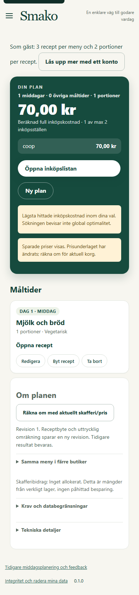
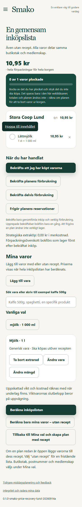

# Läsbar planinformation i alla teman

Aktiverad 2026-10-31T11:23:44.824820+00:00 på https://beta.smako.nu.
[PR 54](https://github.com/ossebosse/smako/pull/54) är på main med
`8af918289149eddee59dc8e4718ede52ffa248ce`. Kod `2d2181aabfb4ce305818d68d80787b57fc2738d1` har samma Git-träd som kodmergen.
Denna rättning följer [PR 53:s aktivering](../plan-shopping-ui-20261031/ACTIVATED.md).

## Rättning och verifiering

Livegranskningen av Översikt visade vit text mot ljus informationsruta.
Sammanfattningskortets typografiregler träffar nu bara direkta sammanfattningar
och undantar data-note. Sökinformation och direkta prisvarningar behåller
brun text (#694f16) mot ljus bakgrund (#fff2d6). CSS-versionen är
planview-20261031b och service worker v33. Beräkning, API och övrig UI-kod består.

Båda typerna av ruta verifierades med den befintliga syntetiska browserfixturen
i Bild, Kompakt, Översikt och dator. 20 PWA-/releasetester passerade utan fel
eller överhoppade fall. Inga Pythonfiler ändrades. Tidigare 120 riktade tester,
verklig avbrytning och bestående listmarkeringar återanvänds endast för exakt
oförändrade funktioner. PR-CI och [main-CI](https://github.com/ossebosse/smako/actions/runs/41195297376) är gröna. Exakt image
klarade isolerade HTTP-/API-, sparnings- och checkoutprov utan nät eller produktionsmountar.

Publikt prov med en ny syntetisk gäst: en italiensk middag för två med mjölk,
högst en butik, standardradie 3 km. Utfall: försök 1: SEARCH_INCOMPLETE, 61,875 s; försök 2: SEARCH_INCOMPLETE, 61,719 s.
Båda försöken saknade slutkontrollerad meny. POST-payloadens hash var identisk;
inga krav ändrades. Felreferenserna och HTTP 422 finns i underlaget. Orsaken
utreds inte vidare i denna CSS-release. Menyleverans inom tidsgränsen är inte
godkänd av dessa prov. Inga fler menyomkörningar gjordes.

Separat publikt varuprov utan måltider, en liter mjölk, max en butik och 3 km:
11,687 s till inköpslista, 10,95 kr,
VERIFIED, passerad checkout och identisk återläsning av
sparad request/plan. Bocken bestod efter omladdning och ändrade inte sparad korg.
Detta separata prov ersätter inte de misslyckade menyproven.

Den publika betan serverade HTML, CSS och service worker med exakt kandidatens
bytehashar. Kontrasten verifierades i de fyra syntetiska browserfallen ovan;
någon ny meny för direkt färgkontroll i liveplanen levererades inte. Inga
JavaScriptfel observerades. Tidigare SEARCH_INCOMPLETE och bred planlatens
är inte lösta av CSS.

## Runtime och återställning

BUILD_ID `app-2d2181aabfb4-a98bfc56`.
Image `sha256:db904d14fd788105c637c48684c336d94fcd56ac945b9edf277b3cfbf037bd5c`.
Bas `sha256:dce7c82f153c78e5aec896416c16a12dbb69d883b5f54ac0174be99ff7b34698`.
Tre statiska filer ändrades, 1008 andra runtimefiler
samt runtimekonfiguration verifierades oförändrade. Endast appen ersattes;
scheduler består på source-ops-8a53beb80e43. Mountar, övrig miljö och prismanifest
bevarades. Lund/Malmö svarade HTTP 200/ready med rätt BUILD_ID.

Ny verifierad backup `/srv/smako/backups/20261031T111141Z` under driftlåset. Tidigare rader:
323 planrevisioner,
134 privata tillstånd,
2 konton och 1 session.
Befintlig retention förroterade extra backupen 20261030T220550Z, med två
fullständiga hashverifierade kopior från i dag kvar. Maxantal två gällde enbart
den processen; installerad policy och reserv ändrades inte. Den nya backupen
återställde tredje kopian. Ordinarie jobb avbröts inte. Retention är complete.
Inför denna release säkrades även den oanvända, tidigare aktiverade bilden
app-562afbb53344-92f00d23 i en åtkomstskyddad lokal Docker-export. Alla åtta
OCI-blobbar, exakt image-ID och tagg verifierades. Ingen container eller effektiv
Compose-tjänst använde bilden. Först därefter togs dess serverreferenser bort
utan force under driftlåset, följt av rensning av enbart oanvänd BuildKit-cache.
Alla container-ID:n, images, mountar och effektiv Compose-konfiguration
bestod. Aktuell app, föregående återställningsbild och ny kandidat var oförändrade.
Uppmätt ledigt utrymme ökade från 7,56 till
41,91 GB över denna avgränsade städning. Logiska
cachetal ska inte adderas till nettomätningen. Privat återställningsmarkör finns
vid den äldre releasens underlag; kopian ligger i
`.local/beta-plan-contrast-20261031/protected-archive/app-562afbb53344-image.tar.gz`.
Installerad retention och reserv ändrades inte; inga volymer eller containrar rensades.

Efter nya backupen är ledigt 32,91 GB mot indikatorns
15,20 GB. Den tidigare kapacitetsvarningen är borta vid efterkontrollen.
Den manuella releasebackupen bevisar inte att ordinarie backupjobb därefter
har körts; dess observerade status finns separat i underlaget.
Prisåldersvarningar och retain-until-replaced-policy består.

Sanerat underlag: [EVIDENCE.json](EVIDENCE.json). Inga privata profiler,
backupfiler, cookies eller hemligheter har lagts i Git.
