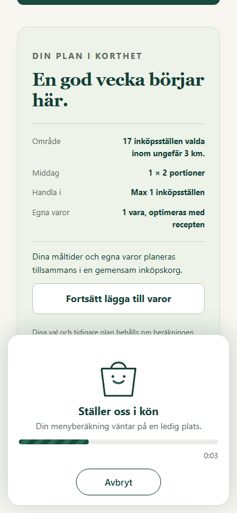
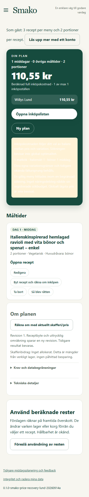
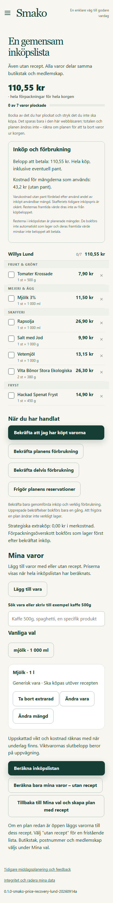

# Förloppspanel, planvy och inköpslista aktiverade

Aktiverad 2026-10-31T10:41:34.993964+00:00 på https://beta.smako.nu.
[PR 53](https://github.com/ossebosse/smako/pull/53) är integrerad på main med
`96506c07b02ce52722b45b462a0391ba742f6f30`. Kod `56caf4ab5f6e87b4475c778fd4715fb050ccff27` har samma Git-träd som kodmergen.

## Ändring och verifiering

Skapa plan visar en panel där knappen satt med serverns steg, uppmätta
räknare, förfluten tid och Avbryt via befintligt jobb-API. Utan räknare är
stapeln obestämd; ingen uppskattad procent eller sluttid visas.
Min plan visar sammanfattning och måltider före Om planen.
Inköpslistan har produktrader i avdelningsordning med bock och strykning,
sparade lokalt per planrevision och rensade vid utloggning. Markeringarna
ändrar inte den sparade korgen, kostnaden eller bokföringen. På mobil följer
planen och listan Bild, Kompakt eller Översikt; dator har grundutseendet.

Alla 120 riktade tester passerade, inklusive Chromium/WebKit, medlemskap,
PWA och paketering. Ruff, compileall, diffkontroll och visuell granskning
passerade. PR-CI och [main-CI](https://github.com/ossebosse/smako/actions/runs/41192099361) är gröna.
Main-körningen gav 4 400 godkända och 63 överhoppade tester, utan fel.
Exakt kandidatimage klarade isolerade HTTP-/API-, sparnings- och checkoutprov utan nätverk eller
produktionsmountar. Nya assets och service worker v32 kontrollerades.

Publikt Chromium-prov: en ny syntetisk gäst avbröt först en riktig beräkning
via UI (DELETE accepterades), fick tillbaka knappen och skapade därefter en
italiensk middag för två med mjölk, högst en butik och standardradie 3 km.
Första kompletta planförsöket nådde SEARCH_INCOMPLETE/HTTP 422 utan
slutkontrollerad lista (felreferens `8b7e3b0b-fe7a-4451-96e8-d58b744257b6`).
En omkörning med samma val tog 43,39 s till renderad meny, total
110,55 kr, `VERIFIED`, med passerad checkout-audit.
Detta lyckade anrop kom efter avbrytningsprovet och det första tidsgränsfelet
och mäter därför inte kallstart eller pålitlig leverans inom tidsgränsen.
Sparad request/plan återlästes identiskt. Alla 7 köprader
visades; bock och strykning bestod efter omladdning, kunde ångras och ändrade
inte den sparade korgens hash. Alla tre teman och datornavigation verifierades.
Inga JavaScriptfel observerades.

## Runtime och databevarande

BUILD_ID `app-56caf4ab5f6e-d90dabe8`.
Image `sha256:dce7c82f153c78e5aec896416c16a12dbb69d883b5f54ac0174be99ff7b34698`.
Faktisk bas `sha256:cb6bc2f48c7862a38fb6748fcfc6e57658cdc2e69e3ce30791c4b791524b76ce`.
Åtta statiska filer ändrades; 1003 andra runtimefiler
samt basbildens runtimekonfiguration verifierades oförändrade. Backend,
beräkningsregler, prisregler och scheman består. Scheduler är fortsatt
`source-ops-8a53beb80e43`; endast appcontainern ersattes.

Backup `/srv/smako/backups/20261031T103156Z` skapades och verifierades under gemensamt driftlås.
322 tidigare planrevisioner,
133 privata tillstånd,
2 konton och 1
sessionsrader bevarades. Mountar, övrig miljö och båda kommunernas
prismanifest verifierades. Lund och Malmö gav HTTP 200/ready med nya BUILD_ID.

## Utrymme och begränsningar

Den äldre extra backupen `20261030T014702Z` säkrades först i en
åtkomstskyddad lokal fil under `.local/beta-plan-ui-20261031/protected-backup/`.
Alla 75 manifestfiler hashverifierades före förrotation av just
serverkopian med befintlig retention under driftlåset. Två verifierade kopior
behölls. Maxantal två gällde enbart den processen; installerad policy ändrades
inte. Ny releasebackup återställde tredje kopian. Inga ordinarie jobb avbröts.
Första aktiveringen stoppade före appbytet: backupens utrymmeskontroll saknade
cirka 133 MB för föreskriven reserv. Därefter säkrades det avslutade arkivet
`joint-week-refinement-e041451/backup-20261016T131323Z.tar.gz` (1,63 GB) lokalt
i `protected-backup/legacy-joint-week-recovery.tar`, tillsammans med ursprungligt
inventarium, kvitto och återställningsanvisning. Gzip-filens SHA-256 matchade
den tidigare verifierade `fbbc31b866b99279532e7440f22c16580453286bac768f3e6efd0803609db052`
både på servern och i lokalkopian före borttagning av just serverns gzip-fil.
Container-/processreferenser kontrollerades under driftlåset. Alla container-ID:n,
images och mountar var oförändrade. En privat EXTERNAL-ARCHIVED-markör bredvid
originalplatsen anger kopian och återställningen. Backupgräns och reserv sänktes inte.
Retention efter aktivering är complete, men ledigt utrymme
2.52 GB mot indikatorns
15.20 GB ger fortsatt kapacitetsvarning.
Ordinarie backupens tidigare InsufficientStorageError ska inte räknas som
åtgärdat av en verifierad releasebackup.

Livegranskningen visade också låg kontrast i Översikts ljusa informationsruta.
Den rättas med en separat CSS-release efter denna verifierade aktivering.
UI-ändringen ändrar inte beräkningens tidsgränser. Tidigare breda
SEARCH_INCOMPLETE-resultat är inte omvärderade eller lösta av detta avgränsade
prov, som heller inte bevisar global optimalitet. Prisåldersvarningar och
retain-until-replaced-policy består. Privat sessionsfil togs bort efter provet;
backuper, cookies, profiler och hemligheter finns inte i Git.

Sanerat underlag: [EVIDENCE.json](EVIDENCE.json).
