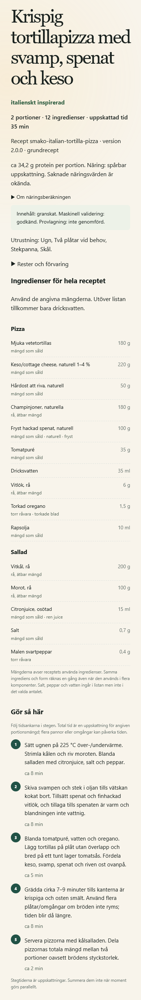

# Receptinnehåll 24 + 24: genomförd import, isolerad verifiering

Runtime **dbd89abbed0a0e3b9d8955badabb17615d6c8d09**, gren
`feature/recipe-content-pack-20261005`. Innehållet är integrerat i det befintliga
receptlagret, PersonalPlanner, PriceUniverse, gemensam veckokorg och audit.
Ingen produktionsaktivering, Git-push, ny butikshämtning eller ändring av relä,
scheman, femkällorspolicy, kommuner eller 36/48-timmarsgränser har gjorts.
[Separat aktiveringsunderlag](ACTIVATION.md).

## Vad som levereras

Paketets färdiga JSON används som oförändrad källa. Ingen ny fri receptgenerering
eller generell receptresearch har gjorts. Adapter: `scripts/recipe_layer/import_content_pack.py`.
Prioritet 1 infördes i `2c4f1ce`, prioritet 2 i `eba660e`; slutlig skärpning av
angiven kryddstyrka, malning och spenatform i `dbd89ab`.

Alla 24 familjeförslag jämfördes med hela det aktuella bibliotekets 104 versioner,
inte enbart tidigare exempelmenyer. [24 motiverade beslut och jämförda ID:n](DEDUPLICATION.json):
**14 nya grundrätter, 10 överlappande familjer som får egna fullskrivna variationer**.
48 nya versioner: 14 grundversioner och 34 variationer. Inga exakta dubbletter
registreras som nya grundrätter. Totalt **62 grundrätter, 90 variationer, 152 versioner**.
Äldre arkivversioner bevaras. Den äldre vardagsgeneratorns 15 generiska rättfamiljer
har också granskats; dess råvarumallar är inte egna fullskrivna 2.0.0-recept.

De tidigare 104 versionernas innehållshash är oförändrad:
`1c623aa7e4a8e8f9cde292807198c59d6f191f0dd3030462a254893995e7e90c`.
Källans SHA-256: `492af59612d7b8ae9ad4b8eb9f2292fc3515f61a1d2aac9edc15464b08a3b36d`.
Det deterministiskt registrerade tilläggets SHA-256:
`d1c5325453bf1d7583658db4a069623777902846c89d7935a80289abc4c2e20c`.

Modellen bevarar komponenternas egna mängder, former, vatten och instruktioner.
Gemensamma råvaror summeras för inköp men fördelningen visas i receptet. Inbäddade
mängder i steg skalas uttryckligen; minuter och temperaturer skalas inte. Fyra
portioners plåt-/pannkapacitet förklaras separat. Källans grova stegberoenden
presenteras inte som en bevisad parallell tidsplan för en ensam kock.

Ny metodversion `smako-authored-input-v2` återanvänder befintlig näringsberäkning
på använda ätbara insatser. Källans avhällning och stekning bevaras. Metoden påstår
inte att allt kokvatten eller all sky serveras. Retention, förlust till panna och
tillagad vikt är okända; näringen märks uppskattad och kräver separat medgivande.
Ingen fysisk provlagning eller uppmätt tillagningstid påstås.

## Faktisk kvalificering och dataluckor

Alla 48 versioner har passerat strukturell validering, mängdsummor, receptschema
och portionsskalning. Alla har dessutom körts genom verklig produktmatchning,
mängd-/näringskontroll, hela inköp och audit på samma autentiska frysta underlag.
[Fullständig redovisning per version och köpläge](QUALIFICATION.json) anger första
faktiska stoppet, separat köp-/näringsstatus, produktval, förpackningar och kostnad.
Underliggande fulla resultat med alla källreferenser ligger utanför Git och binds
av [evidensmanifestet](EVIDENCE-MANIFEST.json).

Kvalificeringsprofil: två portioner, högst två inköpsställen, tomt skafferi,
ingen medlemsförmån, separat näringsmedgivande, protein/kolhydrat/fett minst 0 och
högst 4 000 kcal. Detta provar att hela näringen kan beräknas, **inte att alla
rätter når 30 eller 40 g protein**. Inga mängder ändrades för att passera provet.
Kontrollen använder det inmatade publicerade PriceUniverse-objektet och dess
riktiga kvarhållna fakta; ingen mockprodukt används trots konstruktorns inaktiva
providerinställning i den direkta kvalificeringsharnessen.

| Matkök | Införda versioner | Kvalificerade, uppskattat köp | Kvalificerade, exakt köp | Distinkta kvalificerade familjer före → efter, uppskattat |
| --- | ---: | ---: | ---: | ---: |
| Grekiskt | 8 | 2 | 2 | 8 → 8 |
| Italienskt | 8 | 7 | 3 | 7 → 11 |
| Mexikanskt | 8 | 0 | 0 | 8 → 8 |
| Indiskt | 8 | 0 | 0 | 8 → 8 |
| Thailändskt | 8 | 0 | 0 | 8 → 8 |
| Svenskt | 8 | 2 | 2 | 8 → 9 |
| Totalt | 48 | **11** | **7** | **47 → 52** |

På uppskattad profil går hela biblioteket från 96 till 107 kvalificerade versioner.
De 11 nya kvalificerade versionerna representerar sex familjer, varav fem är netto
nya kvalificerade grundrätter. De övriga 37 registrerade versionerna förblir
synliga datastopp och hindrar inte andra recept från att användas.

Första stopp, utan dubbelräkning, i uppskattat läge:

- 12 versioner: kvalificerad näring saknas för uttryckligen **milt** paprikapulver.
- 2 versioner: motsvarande paprikaunderlag och äpplets näringsunderlag saknas.
- 10 versioner: milda/medelstarka chiliflakes kvalificeras inte med rätt fakta.
- 6 versioner: köp och använd avrunnen majs saknar kvalificerad gemensam mängdgrund.
- 2 versioner: rätt färdigbakat pitabröd med kvalificerad mängd/form saknas.
- 2 versioner: rätt småpasta kvalificeras inte.
- 2 versioner: ägg saknar kvalificerad ätbar mängdgrund.
- 1 version: tonfisk i vatten saknar kvalificerad avrunnen mängdgrund.

I exakt köpläge blir första stoppet ibland tidigare, exempelvis vitkålens
mängdosäkerhet. Därför ska listorna för köplägena inte adderas. En befintlig
chiliflakespost hade motstridig kryddblandningsbeskrivning; den har inte fått
låna identitet eller näring genom en synonym. Mild paprika får inte låna generiskt
pulvers deklaration. Saknad deklaration, densitet eller ätbart utbyte är inte noll.

En preliminär körning med mindre precisa kryddkrav gav 23 kvalificerade versioner
och 698,77 kr för huvudmenyn. Den körningen är **inte slutacceptans**. Den slutliga
skärpningen följer paketets angivna ingredienser och ger resultaten ovan.

## Reproducerbar jämförelse

Bas är den senaste prestandaimagen `b89fadb96c4edc4576cb4daae6c5d80e553ad8ca`,
som redan ingick i arbetskopians sammanhängande kodbas `435c164` när arbetet började.
Den äldre produktionsimagen återinfördes inte som utvecklingsbas.

Vi återanvände föregående prestandaarbetes sanerade, faktiskt sparade femköksbegäran:
fem middagar × fyra portioner, Balanserad, grekiskt/italienskt/mexikanskt/indiskt/
thailändskt tillåtna, 10–15 ingredienser, minst 30 g protein, inget tidstak,
godkända variationer, fisk tillåten, butikstak tre, alla fem medlemskap, tomt skafferi,
uppskattade köp och **separat** näringsmedgivande. Fem tillåtna kök betyder inte
ett krav på en rätt från vart och ett. Begäran är återfunnen, medan originalets
exakta klicktid inte lagrades; replayklockan använder den sparade revisionens tid.
Användarens ursprungliga plan har inte ändrats.

Fryst tid `2026-10-04T07:19:16.028059+00:00`, PriceUniverse-filens SHA-256
`f82d66103e830b82b7d919fe847fd5b3ef85c5e323e0a2133c338f064dfb8768`,
universum `price-universe:b8a677e3e46828048a1946edbeaeb75649cd35f208da826536561fcd4cc90b6c`.
Samma faktaversion `retained-catalog-facts-v9-ready-baked-bread:6d0a692188c0e3efbd674814ececf5ff21208aba0fcc2087c11700970ce473b5`,
katalogdatabas och 2 233 hashbundna råfiler före/efter. Historiska priser är inte
dagens produktionspriser. Inga nya källhämtningar startades.

Samma 2 CPU/3 GiB, samma sökbudget och beroenden. Begärans candidate_recipe_count=80,
beam_width=30 och optimization_iterations=1 har inte sänkts; personlig sökning
använder befintlig intern beam-policy (huvudfallets effektiva bredd 8).
Mätningen är en kall ny process och en varm **ny beräkning** i huvudfallet,
inte återvisning av en färdig plan. Representativa sidofall har ett kallt prov per
version. Dessa enstaka observationer ger ingen statistiskt säker p95.

[Maskinell före/efter-jämförelse med fulla korgar och näring](COMPARISON.json).
Huvudfallets recept, samtliga mängder, produkter, köpvillkor, näringsvärden och
källspår, audit, planerade rester och skafferiallokeringar är exakt lika före/efter.
Kostnaden är **768,04 kr** för inköp och **566,87 kr** för använd mängd, två butiker.
De valda rätterna är palak-tofu, tofu-dal, linschili, sofritas och bönenchiladas.
Inga nya rätter väljs i just den ursprungliga menyn. Sex nya versioner når dess
veckosökning; övriga stoppas av data, proteinmål eller ligger utanför köksvalet.
Detta redovisas per version i QUALIFICATION.json. Ej vald betyder inte bevisat dyrare.

### Tid och resursanvändning

| Prov | Före | Efter |
| --- | ---: | ---: |
| Balanserad kall, process till serialiserat resultat | 82,49 s | 93,11 s |
| Balanserad kall, själva nyberäkningen | 66,51 s | 76,99 s |
| Balanserad varm, nyberäkning | 58,00 s | 64,93 s |
| Kall CPU-tid för nyberäkningen | 66,47 s | 76,81 s |
| Varm CPU-tid för nyberäkningen | 57,98 s | 64,91 s |
| Högsta RSS kall | 1 838 356 KiB | 1 930 828 KiB |
| Högsta RSS efter varm körning | 1 932 080 KiB | 2 053 460 KiB |
| Billigast, 2 portioner, exakt köp, butikstak 2: kall process | 66,59 s | 109,77 s |
| Samma Billigast: nyberäkning | 50,60 s | 94,09 s |
| Varierad, huvudfallets övriga val: kall process | 135,02 s | 149,84 s |
| Samma Varierad: nyberäkning | 118,47 s | 134,04 s |

Utbyggnaden ger ingen uppmätt besparing i huvudfallet och **60-sekundersmålet är
fortfarande inte uppnått**. Billigast behåller samma korg på 534,40 kr; den extra
omvalideringen av den tidigare kandidatpoolens giltiga lösning förklarar merparten
av dess ökning. Begränsad sökning kan annars tappa en redan känd billigare korg.
Varierad behåller också identiska recept, produkter, mängder, näring och rester,
samma korg på 808,76 kr. Dess kalltid ökar med 14,82 s; ingen dold förbättring
påstås. Billigasts högsta RSS är 1 534 832 → 1 638 460 KiB och Varierads
1 848 204 → 1 940 708 KiB.

Jämförelsen kör samma planner, fakta, klocka, privata skafferi och villkor och
slutauditerar den valda lösningen; den hämtar inte en annan ägares sparade plan.

Kandidatgenerering/kvalificering i slutligt kallt huvudfall: 9,81 s, produktfakta
14,54 s, veckosökning 49,92 s, förpackningsberäkning 22,79 s och audit 12,61 s.
Spannen överlappar och ska **inte summeras**. Inga tunga profileringsinstrument
var påslagna i tidsjämförelsen. Nästa kostnader är den gemensamma förpacknings-/
veckosökningen och omvalideringen av Billigasts jämförelselösning.

Den begränsade rena receptcachen utökades från 512 till 1 024 poster: 152 recept
med fyra rena delberäkningar ryms nu utan att hela cachen töms. Versions-/innehålls-
och metodnycklar bevaras. Ingen delad privat plan-/skaffericache har införts.

## Vanliga användarflöden och presentation

På en aktiverad kandidat kommer innehållet in under befintliga **Receptstil →
Genomarbetade middagar** i publik meny och `/personal`. Inga nya parallella
formulär, prismotorer eller betalda modell-API-anrop behövs. Befintligt vardagsläge,
användarval, separat medgivande till uppskattad näring och receptåterkoppling kvarstår.

Riktiga knappflöden mot den verifierade, oförändrade paketimagen i isolerad miljö:

- Chromium, publik mobil 390 px, fem italienska middagar × två, 10–15 ingredienser,
  protein 30 g, två butiker: **28,719 s klick till komplett renderat resultat**.
  Generering, omladdning under väntan och två sekunders nätavbrott passerade.
  Byte väljer nya **IT04-base 2.0.0**, tortillapizza med svamp, spenat och keso.
  Uttrycklig omräkning behåller rätten. Nya hela veckokorgen kostar 660,32 kr,
  använd mängd 353,87 kr; ursprungskorgen kostade 624,58 kr. Det uttryckliga bytet
  är alltså dyrare, inte en påstådd besparing. Pizzans protein är cirka 34,2 g
  per portion med dessa gemensamt valda produkter, inte den fristående korgens 33,4 g.
- WebKit, personlig mobil 390 px, huvudfallet fem middagar × fyra: **79,453 s**
  klick till komplett renderat resultat. Omladdning under generering längre än en
  minut, receptbyte, omräkning och återläsning passerade. Bytet gav 831,09 kr,
  använd mängd 592,71 kr. Detta är en ny uttrycklig revision, inte en omskriven plan.
- Båda flödenas revisioner 1–3 lästes tillbaka identiskt efter faktisk appomstart
  med bibehållen testdatabas. Chromium omfattar både 1.4.0- och 2.0.0-recept.
  Annan ägare nekas plan/jobb; dubbelstart återanvänder jobb. Faktisk DOM/layout,
  ingen horisontell överströmning, svenska näringsdecimaler och kvalitetsmärkning
  verifierades. Inga mockade browserrutter, inga fysiska iPhone-prov.
- Vanliga HTTP-flöden för grekiskt med tomt respektive uttryckligen angivet skafferi:
  682,23 respektive 665,33 kr. Av 500 g angiven potatis används 300 g. Planerade
  rester tillfördes inte lagret. Ägarisolering, dubbelstart och återläsning passerade.

[Sanerade browserbevis](BROWSER.json), [faktiska menyer, produkter, köp, näring och rester](MENUS.json).
Ett separat rendererprov visade samtliga 48 tillagda versioner i Chromium och WebKit,
390 och 1 280 px: 192 godkända renderingar. Detta bevisar visning, inte köpbarhet.

[Bred Chromium-bild av samma sparade recept](chromium-1280-selected-it04.png).
Bilderna återger den verkligt sparade bytesrevisionen med appens renderer och CSS
på en ren presentationsyta; de är inte skärmbilder av en ny produktionsgenerering.

## Tester, kvarstående begränsningar och kandidat

**2 258 backendtester PASS**, inga fel eller överhoppade tester, 281,99 s på den
lokala utvecklingsmaskinen. Deterministisk importkontroll, Ruff och compileall PASS.
Negativa skydd omfattar fel råvaruform, kryddstyrka, okända/motstridiga fakta,
allergener, protein under gränsen, cacheinvalidering samt biblioteksexpansion som
föreslår en dyrare korg eller når sökbudget. Äldre grocery_data-runtime är hashstabil
mot den tidigare kandidatens verifierade kod; dess tidigare 1 664 tester återanvänds
som oförändrat underlag, inte som en ny körning i denna uppgift.

Förpacknings-/källfakta för de 37 stoppade versionerna behöver kompletteras från
verifierade källor innan de kan bli valbara under denna kvalificeringsprofil.
Receptinnehåll, marknadens källtäckning, näring, köpbarhet och ekonomiskt urval är
separata resultat. Frysta kvalificeringstal är ingen garanti för dagens utbud.

Serverpaket: `.local/releases/recipe-content-final-20261005/smako-server-dbd89abbed0a.zip`,
2 824 283 byte, SHA-256
`e6fe6c4698af816d1b1c8f8f36e23a7be770008237672927557ec38a27ebef4c`.
Verifierad image **sha256:a7b0440c6efb19cc2f4b25ae12689656f19f881a2446d7e4f2249d00d0950727**,
BUILD_ID `content-dbd89abbed0a`. Paketets 655 manifestbundna filer (656 zip-poster inklusive manifestet) och 649 installerade
runtimefiler verifierade; pip check och offline-Chromium PASS. Båda knappflödena
körde denna image utan runtimeöverlagring.

Privata/fullstora verifieringsartefakter ligger i `.local/recipe-content-20261005`
och `/var/tmp/smako-content-20261005`. Frysta indata ligger kvar under
`.local/five-cuisine-20261004` respektive `/var/tmp/smako-five-cuisine-20261004/inputs`.
Testcontainern `smako-content-isolated` är stoppad efter proven; tillstånd,
revisioner och konsistent slutbackup är bevarade.
Kopiera aldrig testklocka, databaser eller replaylauncher till produktion.

Slutlig läskontroll av produktion 2026-10-05: fortsatt ready på
`complete-recipes-17a9c1330dcc`, flagga true, image
`sha256:99bf3bfcb4f395ec1a06df23649e0241903d52bb5bba40ca4336abbd2bbecc35`,
samma starttid `2026-10-03T15:22:42.656750552Z`. Det nya innehållspaketet är **inte
aktiverat på beta.smako.nu**. Senare funktionsåtergång ska göras med flaggan av i
samma nya image så att även 2.0.0-planrevisioner kan läsas; ingen äldre databas får
återställas över nya användarplaner.
